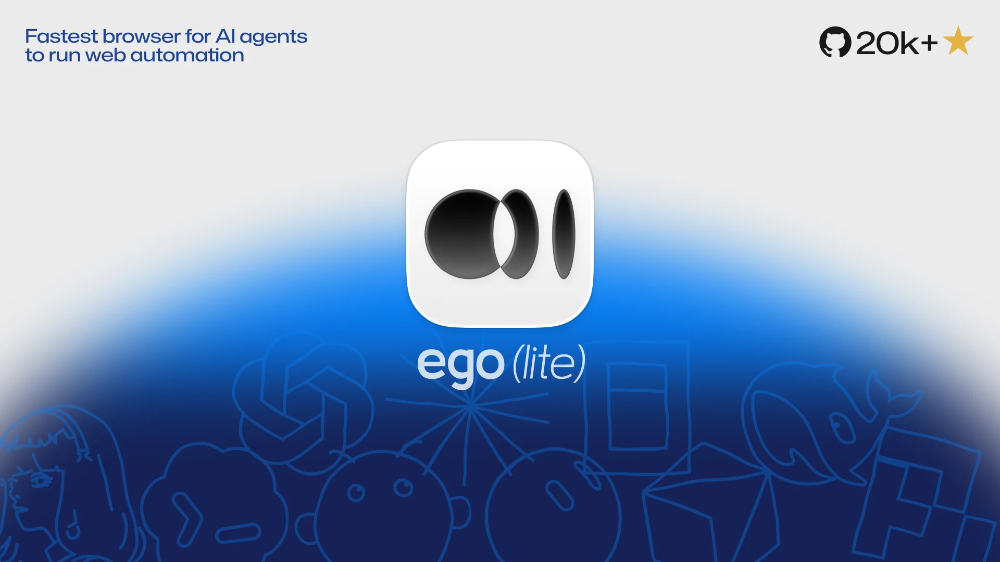
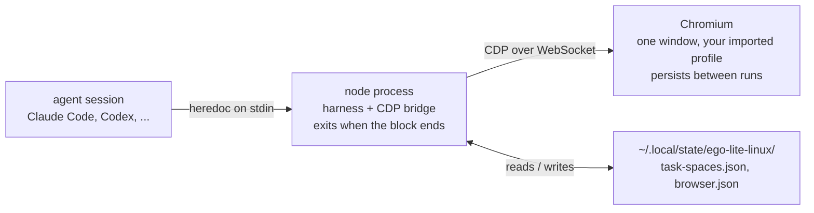
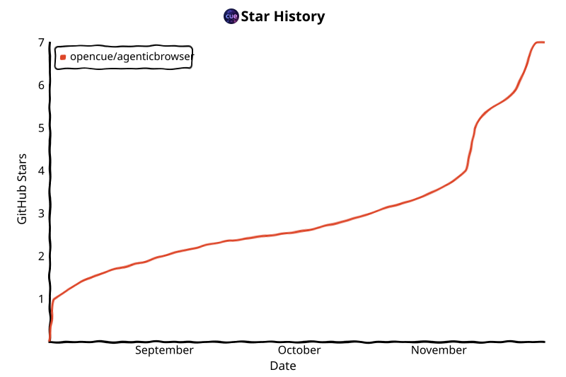

<div align="center">



**A browser you share with your AI agents, on Linux and Windows**

<p>
  <a href="https://github.com/opencue/agenticbrowser/releases/latest"></a>
  <a href="https://github.com/opencue/agenticbrowser/releases/latest/download/ego-lite-setup.exe"></a>
  <a href="https://github.com/opencue/agenticbrowser/releases/latest"></a>
  <a href="https://nodejs.org/"></a>
  <a href="LICENSE"></a>
</p>

</div>

agenticbrowser is a browser where you and your AI agents work in parallel. Your
agents (Claude Code, Codex, Cursor or your own) run their browser tasks in their
own **task spaces**, owned sets of tabs inside one shared Chromium, signed in
with your real logins, while you keep browsing in yours. And because the agent
writes **one JavaScript block** for the whole task instead of a `navigate` →
look → `click` → look round trip per step, runs finish faster on fewer tokens.

It is a Linux-first port of [ego lite](https://github.com/citrolabs/ego-lite):
the same `ego-browser` skill and harness, driving the stock Chrome, Chromium,
Brave or Edge you already have over the Chrome DevTools Protocol. No custom
browser build, and native Windows 10/11 is supported too (beta).

> **Renamed from `opencue/ego-lite-linux`.** GitHub redirects the old URLs; update
> your remote when convenient:
> `git remote set-url origin https://github.com/opencue/agenticbrowser.git`.
> On-disk names (profile directory, `.desktop` entry, icon, window class) keep
> `ego-lite-linux` on purpose, so existing installs are not orphaned.

## Quick Start

### 1. Install

Pick whichever fits your flow.

**1.1 Download a release**

<a href="https://github.com/opencue/agenticbrowser/releases/latest/download/ego-lite-setup.exe"></a>
<a href="https://github.com/opencue/agenticbrowser/releases/latest"></a>
<a href="https://github.com/opencue/agenticbrowser/releases/latest"></a>

Every [release](https://github.com/opencue/agenticbrowser/releases/latest) ships:

| Asset                          | What it is                                                                                         |
| ------------------------------ | -------------------------------------------------------------------------------------------------- |
| `ego-lite-setup.exe`           | Windows installer. Bundles Node, puts `ego-browser` on your `PATH`, drives the Edge you already have. |
| `ego-linux-host-<tag>.tgz`     | The Linux host daemon and CLI, built. Needs Node ≥ 22.                                             |
| `ego-windows-host-<tag>.zip`   | The Windows host with the v2 runtime inside, built. Needs Node ≥ 22.                               |
| `ego-browser-<tag>.zip`        | The `ego-browser` harness bundle.                                                                  |
| `*.sha256`, `SHA256SUMS-hosts.txt` | SHA-256 checksums for the installer and the host archives.                                     |

The Windows installer is not code-signed, so SmartScreen asks once: choose
**More info → Run anyway**.

**1.2 Add the skill with npx**

Install just the `ego-browser` skill:

```bash
npx skills add opencue/agenticbrowser
```

The first time your agent runs a browser task, the skill walks it through
installing the runtime.

**1.3 Let your agent set it up**

Paste this into your agent:

```
Set up agenticbrowser for me: https://github.com/opencue/agenticbrowser

Read `skills/ego-browser/references/install.md` and follow the steps for my operating system.
```

**1.4 From a checkout**

`git clone` and one installer script; see [Install](#install) below.

### 2. Try your first task

Bring your logins across once, then ask your agent in plain language:

```bash
ego-browser --import-chrome-profile
```

```
ego-browser follow @someone on x.com for me
```

The agent picks up the `ego-browser` skill, opens the page in its own task
space, reads a snapshot (the page turned into structured text), acts on the
page, and reports back, all while your own tabs stay untouched. The browser,
its profile and the task-space state all run locally; nothing is hosted.

## Highlights

| Feature                                   | What it does                                                                                                                                                                                       |
| ----------------------------------------- | -------------------------------------------------------------------------------------------------------------------------------------------------------------------------------------------------- |
| **Code-based, not CLI-based**             | The browser is exposed as JavaScript functions the agent calls directly. It composes a multi-step task into one block instead of a "run a command, look, run another" loop: fewer tool calls, fewer tokens. |
| **Stock Chromium, no custom build**       | Drives the Chrome, Chromium, Brave or Edge you already have, over the Chrome DevTools Protocol.                                                                                                    |
| **Your logins carry over**                | Import your Chrome profile once, and agents land on pages already signed in.                                                                                                                      |
| **Parallel, owned task spaces**           | Each task gets its own tabs and an owner, so agents don't collide, and you can hand a space over or take it back halfway through.                                                                |
| **Any agent, CLI or MCP**                 | A heredoc CLI for agents with a shell, and a one-tool MCP server (`ego_browser_run`) for everyone else.                                                                                           |
| **v2 runtime by default**                 | Upstream's `taskSpace` / `task.page` API is the default; scripts written for the original v1 helpers still run on v1, picked per script.                                                         |
| **Linux and Windows**                     | Linux first (X11 and Wayland), plus native Windows 10/11 without WSL.                                                                                                                              |

## agenticbrowser vs existing products

Most tools can automate a browser. The real questions are what browser the agent
gets, whether you can keep working at the same time, and whether the tool is
built for the agent you already use or a built-in one.

| Feature                          | agenticbrowser | Browser extensions<br><sub>Claude/Codex in Chrome</sub> | Built-in browsers<br><sub>Claude/ChatGPT built-in browser</sub> | Cloud browsers<br><sub>Browserbase/Browser Use</sub> | Browser CLIs<br><sub>playwright-cli/Browser Harness</sub> | AI browsers<br><sub>Comet/Dia</sub> |
| -------------------------------- | :------------: | :-----------------------------------------------------: | :-------------------------------------------------------------: | :--------------------------------------------------: | :-------------------------------------------------------: | :---------------------------------: |
| Works with any AI agent          |       ✓        |                            —                            |                                —                                |                          ✓                           |                             ✓                             |                  —                  |
| Uses your browser logins         |       ✓        |                            ✓                            |                                —                                |                          —                           |                             —                             |                  ✓                  |
| Works across your whole computer |       ✓        |                            —                            |                                ✓                                |                          —                           |                             ✓                             |                  —                  |
| Doesn't hijack your browser      |       ✓        |                            —                            |                                ✓                                |                          ✓                           |                             —                             |                  —                  |
| Parallel multitasking            |       ✓        |                            —                            |                                —                                |                          ✓                           |                             —                             |                  —                  |
| Runs large scraping jobs         |       ✓        |                            —                            |                                —                                |                          ✓                           |                             ✓                             |                  —                  |
| Works as your daily browser      |       —        |                            ✓                            |                                —                                |                          —                           |                             —                             |                  ✓                  |
| Runs on Linux                    |       ✓        |                            ✓                            |                                —                                |                          ✓                           |                             ✓                             |                  —                  |
| Free and open source             |       ✓        |                            —                            |                                —                                |                          —                           |                             ✓                             |                  —                  |
| Data stored locally              |       ✓        |                            ✓                            |                                ✓                                |                          —                           |                             ✓                             |                  —                  |
| Reusable site skills             |       ✓        |                            —                            |                                —                                |                          —                           |                             —                             |                  —                  |

The competitor columns follow [upstream's comparison](https://github.com/citrolabs/ego-lite#ego-lite-vs-existing-products).
agenticbrowser drives a separate agent profile, so it sits beside your daily
browser rather than replacing it, and its reusable site skills ship today in
[`skills/ego-browser/learnings`](skills/ego-browser/learnings).

---

## Requirements

|             |                                                                                                                         |
| ----------- | ----------------------------------------------------------------------------------------------------------------------- |
| **OS**      | Linux (primary), or native Windows 10/11 (beta). WSL is not required.                                                   |
| **Node**    | 22 or newer for checkout installs; the packaged Windows setup bundles it.                                               |
| **Browser** | Chrome, Chromium, Brave, or Edge. Linux searches `PATH` or `EGO_LINUX_CHROME`; Windows searches standard install paths. |

## Install

### Install on Linux

```bash
git clone https://github.com/opencue/agenticbrowser.git
cd agenticbrowser
sh skills/ego-browser/scripts/install.sh
```

The installer checks Node and your browser, builds the harness, installs the MCP
runtime dependencies, links `ego-browser` and `ego-browser-mcp` into
`~/.local/bin` (override with `EGO_LINUX_BIN_DIR`), and runs diagnostics.

<details>
<summary>Doing it by hand</summary>

```bash
cd package/ego-browser && CI=true npm ci && CI=true npm run build
cd ../ego-linux && npm ci && npm test # verify the port: headless, throwaway profile
ln -s "$PWD/bin/ego-browser.mjs" ~/.local/bin/ego-browser
ln -s "$PWD/bin/ego-browser-mcp.mjs" ~/.local/bin/ego-browser-mcp
```

`CI=true` is required, not cosmetic: the harness's `prepare` script runs
`lefthook install`, which fails on any machine with a global `core.hooksPath`,
and `CI=true` is that script's own escape hatch.

</details>

### Install on Windows

From a checkout, run the native PowerShell installer (no WSL needed):

```powershell
git clone https://github.com/opencue/agenticbrowser.git
cd agenticbrowser
powershell -ExecutionPolicy Bypass -File .\skills\ego-browser\scripts\install-windows.ps1
```

It builds the harness, installs per-user `ego-browser.cmd` and
`ego-browser-mcp.cmd`, updates the user `PATH`, and runs diagnostics without
opening the browser. Open a new PowerShell afterwards. Tagged releases also
attach a bundled `ego-lite-setup.exe` for machines without Node.

---

## Walkthrough

Five steps, one command each.

### 1. Bring your logins across

```bash
ego-browser --import-chrome-profile
```

Copies the `Default` directory of your real Chrome, Chromium, Edge or Brave
profile into the agent's own profile, so cookies and logins carry into agent
tasks. Stop the backing browser first (`ego-browser --stop`) if it is running.

### 2. Open the agent browser

```bash
ego-browser --open
```

A Chromium window appears. It is **not** your everyday browser: it runs from a
separate profile under `~/.local/share/ego-lite-linux/profile`, has its own
window class, and its profile chip reads **`ego lite — agent`**, so you can always
tell which window an agent is driving. Run it again any time to raise it.

### 3. Run your first task

The interface is a heredoc of JavaScript on stdin, with every helper preloaded:

```bash
ego-browser nodejs <<'JS'
const task = await taskSpace('first task')
const page = task.page('p1')          // every new space opens with page p1
await page.goto('https://example.com')
console.log(await page.snapshot())
await task.finish({ keep: [] })       // or keep: ['p1'] to leave it open for you
JS
```

`page.snapshot()` returns the semantic view of the page: the roles, accessible
names and refs a model reads to "see" it. From an agent CLI you normally don't
type this yourself; the agent loads the `ego-browser` skill and writes the block
for you:

```
ego-browser follow @someone on x.com for me
```

No heredoc in your shell? `ego-browser nodejs -e '<code>'` takes the same script
as one argument, and `ego-browser nodejs < task.mjs` reads it from a file.
`ego-browser skill` prints the full usage guide.

### 4. Work in a task space

A task space is a named set of pages with an owner. Spaces use the live agent
profile by default, so cookies, `localStorage`, IndexedDB and service-worker
state are shared everywhere you are signed in (see
[below](#task-spaces-share-live-login-state)).

| Call                              | What it means                                                                 |
| --------------------------------- | ----------------------------------------------------------------------------- |
| `await taskSpace(nameOrId)`       | Create the space, or resume one still in the agent's control. Names are unique. |
| `task.page('p1')`, `task.newPage()` | Pages keep their labels (`p1`, `p2`, …) across rounds until `finish()`. |
| `await task.handOff()`            | Pass the space to you (login, captcha, manual confirmation).                  |
| `await takeOverTaskSpace(id)`     | The agent takes back a space it handed to you.                                |
| `await claimTaskSpace(id)`        | Resume a space the agent finished with pages kept open for you.               |
| `await task.finish({ keep })`     | Done. `keep` lists the pages to leave open as yours; `[]` closes them all.    |

Spaces whose tabs you close by hand are reconciled away on the next call.

> **Ownership is enforced at the bridge.** While you control a space, the agent's
> page operations fail with `EGO_TASK_SPACE_USER_IN_CONTROL` until control is
> handed back.

#### The v1 runtime

Scripts written against the original API (`page`, `taskSpaces`, `browser`,
`site` globals) keep working: the CLI runs them on the v1 runtime when it sees
those globals and no v2 call such as `taskSpace(`.

```bash
ego-browser nodejs <<'JS'
await taskSpaces.run('research task', async (task) => {
  await page.goto('https://example.com')
  console.log(await page.snapshot())
})
JS
```

Set `EGO_BROWSER_RUNTIME=v1` or `v2` to force a runtime. v1 reference:
[`skills/ego-browser/references/v1-api.md`](skills/ego-browser/references/v1-api.md);
details: [package/ego-linux/README.md](package/ego-linux/README.md#two-runtimes).

### 5. Put it on your app launcher (Linux)

```bash
ego-browser --install-desktop-entry
```

Writes an XDG desktop entry and a scalable icon, then refreshes the desktop and
icon caches. Clicking it runs `--launch`, which opens each URL `xdg-open` passes,
or the Spaces overview with no arguments.

The entry pins **the absolute path of the node that installed it**, because a
desktop session's `PATH` is not your shell's: a node from nvm, fnm or asdf would
be invisible and the icon would fail silently. **Re-run this after switching Node
versions.**

## MCP host integration

A local stdio MCP server (modular `@modelcontextprotocol/server` v2 SDK)
negotiates the `2026-07-28` protocol with current clients and keeps the legacy
fallback for older hosts. Point your host at `ego-browser-mcp` with no arguments.

Codex (`~/.codex/config.toml`):

```toml
[mcp_servers.ego-browser]
command = "ego-browser-mcp"
```

Claude Code:

```bash
claude mcp add ego-browser -- ego-browser-mcp
```

The server exposes **one tool**, `ego_browser_run`. Its `script` argument is the
same JavaScript you would send through a heredoc; `timeoutMs` is optional and
defaults to 120 seconds:

```json
{
  "script": "await page.goto('https://example.com'); console.log(await page.snapshot())",
  "timeoutMs": 120000
}
```

Each call runs through the CLI in an owned child process: protocol stdout stays
separate from script output, calls on one connection are serialized,
cancellation kills the child, and captured output is capped at 1 MiB.

**Why one tool?** Mirroring every helper as its own MCP tool would turn one
composable program back into a `navigate` → look → `click` → look chain, paying a
model round trip per step. One tool, one program keeps the same speed as the CLI.

---

## How it works

Every heredoc is its own short-lived Node process. The browser, not the process,
is what has to survive, so state lives in files.



- **One browser, reused.** The first run launches Chromium with
  `--remote-debugging-port=0`, reads the negotiated port from `DevToolsActivePort`
  and records it. Later runs attach to that port if it answers, so consecutive
  commands see the same browser and tabs.
- **Page zoom is forced to 100%.** An imported profile brings your zoom along; at
  150% a 1280px window lays out as 853 CSS px, and coordinate clicks land on
  nothing.
- **The window is 1280×900 at device scale factor 1**, so layout doesn't depend on
  your desktop's HiDPI setting.
- **Stale `SingletonLock` is cleared** before launch, so a browser killed without
  a clean shutdown doesn't block the next one with "Failed to create a
  ProcessSingleton".
- **Low memory → headless.** If `EGO_LINUX_HEADLESS` is unset and available
  memory is below `EGO_LINUX_LOW_MEMORY_MB` (default 4096), the browser starts
  headless and trimmed.

### Task spaces share live login state

Default task-space tabs live in the agent profile's default browser context. That
is the only stock-Chromium path that shares **all** login state live (cookies,
`localStorage`, IndexedDB, CacheStorage, service workers), so a login made in
one space is visible in the next without a copy step.

If storage isolation matters more than live logins, set
`EGO_LINUX_TASK_SPACE_STORAGE=isolated`. Each space then gets its own browser
context seeded with cookies only; non-cookie auth stores don't carry over. See
[`docs/isolation-with-inherited-logins.md`](docs/isolation-with-inherited-logins.md).

Bridge internals, method by method, are in
[`package/ego-linux/README.md`](package/ego-linux/README.md).

## Command reference

| Command                               | What it does                                                                                       |
| ------------------------------------- | -------------------------------------------------------------------------------------------------- |
| `ego-browser --status`                | Connection state of the backing browser, as JSON.                                                  |
| `ego-browser --open`                  | Open or raise the shared agent browser window.                                                     |
| `ego-browser --launch [url\|file …]`  | Open each URL or file in a tab and raise the window; no arguments shows the Spaces overview.       |
| `ego-browser --spaces`                | Open the Spaces overview panel.                                                                    |
| `ego-browser --doctor [--json]`       | Inspect installation and runtime state without starting or attaching to the browser.               |
| `ego-browser --cleanup-session`       | Close this agent session's spaces and stop its recognised dev servers.                             |
| `ego-browser --stop`                  | Terminate the backing browser and clear its profile lock.                                          |
| `ego-browser --import-chrome-profile` | Copy your real Chrome profile in, so agent tasks inherit your logins.                              |
| `ego-browser --install-desktop-entry` | Add it to your app launcher, with an icon.                                                         |
| `ego-browser --headless`              | Run the backing browser headless. Only affects the first launch.                                   |
| `ego-browser --help`                  | Usage.                                                                                             |

### Where things live

| Path                                                            | What                                                                     |
| --------------------------------------------------------------- | ------------------------------------------------------------------------ |
| `~/.local/share/ego-lite-linux/profile`                         | The agent's browser profile, where imported Chrome data goes.            |
| `~/.local/state/ego-lite-linux/`                                | `browser.json` and `task-spaces.json`, the state shared across runs.     |
| `~/.local/share/applications/ego-lite-linux.desktop`            | The app launcher entry.                                                  |
| `~/.local/share/icons/hicolor/scalable/apps/ego-lite-linux.svg` | Its icon.                                                                |

Both roots follow `XDG_DATA_HOME` / `XDG_STATE_HOME` when set.

### Environment overrides

| Variable                         | Effect                                                                                                    |
| -------------------------------- | --------------------------------------------------------------------------------------------------------- |
| `EGO_LINUX_CHROME`               | Which browser binary to launch.                                                                           |
| `EGO_LINUX_PROFILE`              | Which profile directory to use.                                                                           |
| `EGO_LINUX_CDP_URL`              | Attach to an already-running DevTools endpoint instead of launching one.                                  |
| `EGO_LINUX_BIN_DIR`              | Where `install.sh` links the CLI. Defaults to `~/.local/bin`.                                             |
| `EGO_LINUX_HEADLESS`             | `1` launches headless by default; `--open` still gives a visible window.                                  |
| `EGO_LINUX_LOW_MEMORY_MB`        | Below this much available memory (default `4096`) a launch is headless and trimmed; `0` turns it off.     |
| `EGO_LINUX_TASK_SPACE_STORAGE`   | `isolated` or `isolated-sync` for per-space browser contexts (cookies only).                              |
| `EGO_LINUX_CURSOR`               | `0` hides the agent cursor overlay in screenshots.                                                        |
| `EGO_BROWSER_ARTIFACT_TTL_HOURS` | How long screenshots, failure artifacts and temp download dirs are kept. Default 24 hours.               |

## Troubleshooting

| Symptom                                 | Cause and fix                                                                                                                     |
| --------------------------------------- | --------------------------------------------------------------------------------------------------------------------------------- |
| `Failed to create a ProcessSingleton`   | A browser died without releasing `SingletonLock`. The launcher clears it automatically; if it persists, run `ego-browser --stop`. |
| Clicking the launcher icon does nothing | Usually a Node version switch; the entry pins an absolute node path. Re-run `ego-browser --install-desktop-entry`.                |
| `no Chrome/Chromium binary found`       | None of the candidates are on `PATH`. Set `EGO_LINUX_CHROME` to an absolute path.                                                 |
| No window appears                       | The browser is headless (an earlier `--headless`, `EGO_LINUX_HEADLESS`, or low memory). `ego-browser --open` swaps it for a visible one. |
| `npm ci` fails in `package/ego-browser` | A global `core.hooksPath` breaks `lefthook install`. Use `CI=true npm ci`.                                                        |

## Verification

Two suites, run one at a time, since both drive a browser:

```bash
cd package/ego-linux && npm test        # the bridge, headless, against a local fixture
cd package/ego-browser && npm run e2e   # real-browser suite, needs ego-browser on PATH
```

> **Known flake: canvas drawing under load.** The three canvas cases occasionally
> count one stroke too many. `driver/pointer.ts` `finishDragProbe` waits 50 ms for
> a trusted `mouseup` and re-synthesises the drag in JavaScript if it hasn't seen
> one; when the real events land late, the page gets both. Details in
> [`docs/canvas-drag-flake.md`](docs/canvas-drag-flake.md).

## Community

- [Issues](https://github.com/opencue/agenticbrowser/issues), bugs and feature requests
- [Releases](https://github.com/opencue/agenticbrowser/releases), changelogs and downloads
- Upstream: [citrolabs/ego-lite](https://github.com/citrolabs/ego-lite), the macOS/Windows app this port follows

## Star History

<a href="https://github.com/opencue/agenticbrowser/stargazers">
<!-- star-history:start -->
<picture>
  <source media="(prefers-color-scheme: dark)" srcset="assets/star-history/star-history-dark.svg">
  
</picture>
<!-- star-history:end -->
</a>

## License

[MIT](LICENSE). Originally derived from
[`citrolabs/ego-lite`](https://github.com/citrolabs/ego-lite); its
`Copyright (c) 2026 CitroLabs` notice is retained as the license requires. This
project is not affiliated with or endorsed by CitroLabs.
